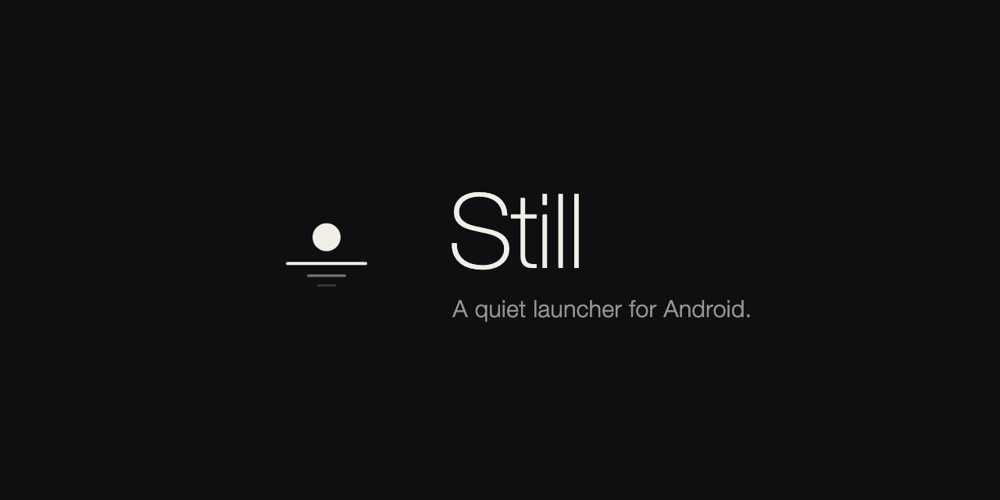

<p align="center">
  
</p>

<p align="center">
  <b>A home screen made of words, not icons.</b><br>
  No ads. No account. No paid tier. No tracking.
</p>

<p align="center">
  <a href="https://github.com/DeharengOlivier/still-launcher/releases/latest"><b>Download the latest APK</b></a>
  &nbsp;·&nbsp; Android 7.0 and later &nbsp;·&nbsp; GPL-3.0
</p>

---

## Why Still

Most launchers compete for your attention. Still gets out of the way: a clock, the date, and the few apps you chose, written in plain text on a dark screen. Everything else is one swipe away, and nothing launches unless you tap it.

## Gestures

| On the home screen | What happens |
|---|---|
| Swipe right to left | The full app list slides in from the right |
| Pull down once | The status bar appears |
| Pull down again | Notifications open; when you close them, the bar hides again |
| Long press | Edit mode: rows jiggle, drag to reorder |
| Tap a group | It opens below its name |
| Bottom-left, bottom-right | Phone and camera |

In the app list, swipe left to right to go back home, and use the gear in the top corner for settings.

## Features

**Your home, unlimited.** Add as many apps as you like and gather them in named groups (`msg`, `banque`, `ia`...). A light chevron marks each group.

**An edit mode you already know.** Long press and the rows start to jiggle. Drag a row to move it, tap the pencil to rename, tap the cross to remove. It works for apps inside groups too.

**One name per app.** Rename an app once, from home or from the app list, and the new name shows everywhere.

**Search that only searches.** Typing filters the list. It never opens an app on its own.

**A calm top of the screen.** The system status bar is hidden on home, since Still already shows the time; it comes back in every other app.

**Sizes you control.** The clock, app names and apps inside groups each have their own size.

## Banking apps that refuse accessibility services

Some banking apps will not open while any accessibility service runs, which includes gesture apps. Mark such an app as **protected** (app list, long press, More, Protect). When you open it, Still switches accessibility services off and shows the system button bar so you always have a way back. When you return home, everything is switched back on.

This needs a one-time permission, granted from a computer:

```sh
adb shell pm grant app.stilllauncher android.permission.WRITE_SECURE_SETTINGS
```

## Set up your home from a computer (optional)

The whole home screen can be written over adb. The receiver is guarded by `android.permission.DUMP`, which only the adb shell holds, so no installed app can use it.

```sh
SPEC='{"entries":[{"app":"com.android.chrome"},{"group":"msg","apps":["org.telegram.messenger"]}]}'
adb shell am broadcast -a app.stilllauncher.IMPORT_HOME_LAYOUT \
  -n app.stilllauncher/app.still.helper.HomeLayoutImportReceiver \
  --es spec_b64 "$(printf '%s' "$SPEC" | base64)"

# Undo the last import
adb shell am broadcast -a app.stilllauncher.IMPORT_HOME_LAYOUT \
  -n app.stilllauncher/app.still.helper.HomeLayoutImportReceiver --ez restore_backup true
```

## Build from source

```sh
./gradlew testDebugUnitTest assembleRelease
```

The brand assets live in `docs/brand/` (`logo.svg`, and `banner.html` to regenerate `banner.png`).

## License and origin

Still is free software under the GNU General Public License v3.0 (see `LICENSE`).

Still is derived from [Olauncher](https://github.com/tanujnotes/Olauncher) by Tanuj, also GPL-3.0. Original code remains copyright of its authors; changes since the fork are by Olivier Dehareng. Still is an independent project and is not affiliated with or endorsed by Olauncher.
